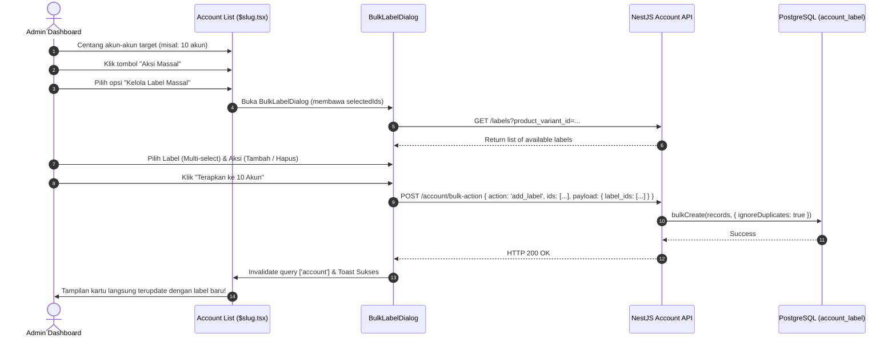

# Rancangan Implementasi: Bulk Labeling (Kelola Label Akun Massal)

Dokumen ini merinci arsitektur, alur kerja (workflow), dan spesifikasi teknis untuk mengimplementasikan fitur **Bulk Labeling (Tambah & Hapus Label Massal)** pada akun di dashboard.

---

## 1. Latar Belakang & Masalah

Saat ini, penambahan label ke akun hanya dapat dilakukan melalui dua cara:
1. **Satu per satu per kartu akun**: Melalui tombol `+ Tambah Label` di masing-masing kartu akun (`AccountLabelSelector`). Jika admin ingin menandai 20, 50, atau 100 akun sekaligus, admin harus mengeklik tombol tersebut puluhan kali.
2. **Form Edit Massal (`AccountBulkEditForm`)**: Tersembunyi di dalam form besar yang menggabungkan Password, Expiry, Status, Billing, dan Varian, serta hanya mendukung pemilihan **satu label tunggal** saja.

### Kebutuhan Pengguna
Admin membutuhkan alur kerja yang cepat dan intuitif:
- Cukup mencentang beberapa akun (misal 5 akun, 20 akun, atau via tombol **Select All**).
- Membuka menu **Aksi Massal** -> Pilih **Kelola / Tambah Label Massal**.
- Muncul dialog modal khusus yang menampilkan daftar label yang tersedia dengan badge warna.
- Admin dapat memilih satu atau beberapa label sekaligus (**Multi-select**), lalu mengeklik tombol **Terapkan Label**.
- Secara instan, seluruh akun yang dipilih akan langsung mendapatkan label tersebut tanpa menghapus label-label yang sudah terpasang sebelumnya.
- Tersedia juga opsi untuk **Melepas / Menghapus Label Massal** jika admin ingin mencabut label tertentu dari sekelompok akun.

---

## 2. Arsitektur & Alur Sistem (Flow)



---

## 3. Rincian Teknis Backend (`apps/api`)

### 3.1. Penambahan Action pada `AccountService.bulkAction`
File target: [account.service.ts](file:///e:/latihan%20coding/1volvecapital/volvecapital/apps/api/src/modules/account/account.service.ts)

Pada method `bulkAction(tenantId, ids, action, payload)` di dalam blok `switch (action)`:

#### A. Aksi `'add_label'`
Menambahkan satu atau beberapa label ke daftar akun tanpa menghapus label yang sudah ada:
```typescript
case 'add_label': {
  const labelIds: string[] = Array.isArray(payload?.label_ids)
    ? payload.label_ids
    : (payload?.label_id ? [payload.label_id] : []);

  if (labelIds.length > 0 && ids.length > 0) {
    const validAccounts = await this.accountRepository.findAll({
      where: { id: { [Op.in]: ids } },
      attributes: ['id'],
      transaction,
    });

    const records: { account_id: string; label_id: string }[] = [];
    for (const acc of validAccounts) {
      for (const lId of labelIds) {
        records.push({
          account_id: acc.id,
          label_id: lId,
        });
      }
    }

    if (records.length > 0) {
      // Menggunakan ignoreDuplicates agar tidak error jika relasi sudah ada
      await this.accountLabelRepository.bulkCreate(records, {
        ignoreDuplicates: true,
        transaction,
      });
    }
  }
  break;
}
```

#### B. Aksi `'remove_label'`
Mencopot satu atau beberapa label dari daftar akun terpilih:
```typescript
case 'remove_label': {
  const labelIds: string[] = Array.isArray(payload?.label_ids)
    ? payload.label_ids
    : (payload?.label_id ? [payload.label_id] : []);

  if (labelIds.length > 0 && ids.length > 0) {
    await this.accountLabelRepository.destroy({
      where: {
        account_id: { [Op.in]: ids },
        label_id: { [Op.in]: labelIds },
      },
      transaction,
    });
  }
  break;
}
```

### 3.2. Database Safety
Tabel `account_label` telah memiliki unique index gabungan `account_label_unique_idx (account_id, label_id)` (lihat migration `048-create-label-tables.ts`).
Penggunaan `ignoreDuplicates: true` pada `bulkCreate`:
- Menjamin eksekusi super cepat (1 query SQL `INSERT INTO ... ON CONFLICT DO NOTHING`).
- Aman dan idempoten jika sebagian akun sudah memiliki label tersebut.

---

## 4. Rincian Teknis Frontend (`apps/dashboard`)

### 4.1. Komponen Modal: `AccountBulkLabelDialog`
File baru: `apps/dashboard/src/components/account-bulk-label-dialog.tsx`

**Fitur Komponen:**
1. **Header**: Menampilkan jumlah akun terpilih, contoh: *"Kelola Label Massal (12 Akun Terpilih)"*.
2. **Tab Mode**:
   - **Tambah Label**: Memasang label terpilih ke seluruh akun.
   - **Hapus Label**: Mencopot label terpilih dari seluruh akun.
3. **Pilihan Label (Multi-select)**:
   - Menampilkan badge label dengan warna aslinya (`label.color`).
   - Checkbox / Clickable Pill untuk memilih satu atau beberapa label.
   - Input pencarian (search) jika jumlah label banyak.
4. **Shortcut Buat Label Baru**:
   - Tombol mini untuk langsung menambah label baru jika label yang diinginkan belum ada.
5. **Tombol Eksekusi**:
   - Memiliki loading state (`isPending`) saat request sedang dikirim.
   - Menampilkan toast sukses: *"Berhasil menambahkan label ke 12 akun"*.

### 4.2. Integrasi ke Halaman Akun (`$slug.tsx`)
File target: [apps/dashboard/src/routes/dashboard/account/$slug.tsx](file:///e:/latihan%20coding/1volvecapital/volvecapital/apps/dashboard/src/routes/dashboard/account/$slug.tsx)

1. **State Modal**:
   ```tsx
   const [dialogBulkLabelOpen, setDialogBulkLabelOpen] = useState<boolean>(false);
   ```

2. **Menu Dropdown "Aksi Massal"**:
   Tambahkan opsi setelah `Edit Massal`:
   ```tsx
   <DropdownMenuItem onSelect={() => setDialogBulkLabelOpen(true)}>
     <Tag className="mr-2 h-4 w-4" />
     Kelola Label Massal
   </DropdownMenuItem>
   ```

3. **Render Dialog**:
   ```tsx
   <AccountBulkLabelDialog
     open={dialogBulkLabelOpen}
     onOpenChange={setDialogBulkLabelOpen}
     selectedIds={selectedIds}
     productVariantId={searchParam.product_variant_id || product?.variants?.[0]?.id || ''}
     onSuccess={() => {
       setSelectedIds([]);
       queryClient.invalidateQueries({ queryKey: ['account'] });
     }}
   />
   ```

---

## 5. Mockup Tampilan Dialog UI

```
+-------------------------------------------------------------+
|  🏷️ Kelola Label Massal                                     |
|  Atur label untuk 12 akun yang sedang dipilih.              |
+-------------------------------------------------------------+
|  [➕ Tambah Label]     [➖ Hapus Label]                     |
|                                                             |
|  Pilih Label:                                               |
|  [ Cari label...                                          ] |
|                                                             |
|  ☑️ [🔵 Admin Gilang]      ☑️ [🟢 Sisa 1 Slot]              |
|  ⬜ [🟣 Akun Cadangan]     ⬜ [🟡 Perlu Perpanjang]         |
|  ⬜ [🔴 Problem Kartu]                                      |
|                                                             |
|  + Buat Label Baru                                          |
+-------------------------------------------------------------+
|  Catatan: Label yang dipilih akan ditambahkan ke 12 akun    |
|  tersebut tanpa menghapus label yang sudah ada.             |
+-------------------------------------------------------------+
|                          [ Batal ]  [ Simpan ke 12 Akun ]   |
+-------------------------------------------------------------+
```

---

## 6. Skenario Pengujian (Testing Steps)

1. **Skenario 1: Tambah Label Massal (1 Label ke Banyak Akun)**
   - Centang 3 akun Netflix Harian di halaman dashboard.
   - Buka **Aksi Massal** -> Klik **Kelola Label Massal**.
   - Pilih mode **Tambah Label**, centang label `Admin Gilang`.
   - Klik **Simpan ke 3 Akun**.
   - **Hasil yang diharapkan**: Ketiga kartu akun langsung memunculkan badge `Admin Gilang`. Akun yang sebelumnya sudah memiliki label lain tetap mempertahankan label lamanya.

2. **Skenario 2: Tambah Multiple Labels Sekaligus**
   - Centang 5 akun.
   - Buka dialog, centang 2 label sekaligus: `Admin Gilang` dan `Sisa 1 Slot`.
   - Klik Simpan.
   - **Hasil yang diharapkan**: Kelima akun langsung memiliki kedua badge tersebut.

3. **Skenario 3: Idempoten (Akun Sudah Punya Label Tersebut)**
   - Pilih akun A (sudah ada label `Admin Gilang`) dan akun B (belum ada label).
   - Jalankan Bulk Add Label `Admin Gilang`.
   - **Hasil yang diharapkan**: Tidak terjadi error duplikasi SQL. Akun B mendapat label `Admin Gilang`, dan akun A tetap valid dengan 1 label `Admin Gilang`.

4. **Skenario 4: Hapus Label Massal**
   - Centang 5 akun yang memiliki label `Sisa 1 Slot`.
   - Buka dialog, pilih mode **Hapus Label**, centang label `Sisa 1 Slot`.
   - Klik **Hapus dari 5 Akun**.
   - **Hasil yang diharapkan**: Badge `Sisa 1 Slot` terhapus dari kelima akun tersebut.

---

## 7. Kesimpulan & Rekomendasi
Fitur Bulk Labeling ini dapat diimplementasikan secara bersih dan modular:
1. Backend memanfaatkan `AccountService.bulkAction` yang sudah ada dengan action `'add_label'` dan `'remove_label'`, serta performa tinggi via `bulkCreate(..., { ignoreDuplicates: true })`.
2. Frontend menggunakan komponen dialog terpisah (`AccountBulkLabelDialog`) yang rapi, cepat, dan terhubung langsung ke dropdown **Aksi Massal**.

