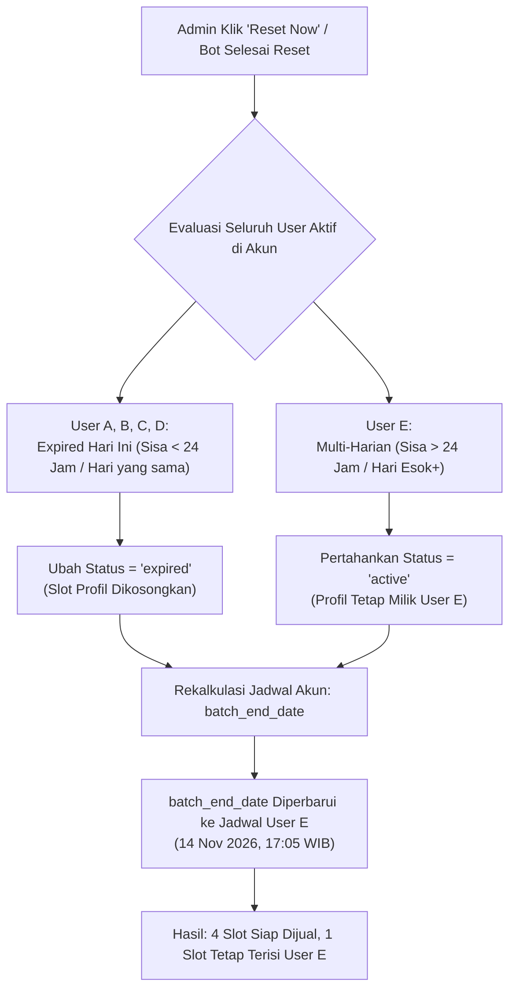

# Rencana Implementasi: Smart Clear Slot Saat Trigger Reset Password Akun

Dokumen ini menjelaskan rancangan sistem pembersihan slot user profil otomatis (**Smart Clear Slot**) ketika dilakukan pemicuan reset password akun (baik secara manual dari Dashboard maupun otomatis oleh Bot), dengan tetap **melindungi user sewa multi-harian (2-3 hari)** agar tidak terhapus.

---

## 1. Latar Belakang Masalah

Pada sistem rental Netflix harian:
* 1 Akun Netflix memiliki **5 profil** yang disewakan ke pembeli berbeda.
* Saat ini, pembersihan profil user hanya berjalan jika kondisi database terpenuhi:
  ```sql
  WHERE expired_at <= NOW()
  ```
* **Masalah yang Terjadi:**
  Ketika Admin menekan tombol **"Reset Password"** atau **"Aksi Massal -> Bulk Reset"** di sore hari (misal jam **16:45 WIB**), bot akan mengubah password di Netflix dan mengeluarkan seluruh perangkat (*Sign out of all devices*).
  Namun:
  - User harian yang masa sewanya habis hari ini jam **17:05**, **17:08**, **17:11**, dan **17:33** **TIDAK TER-CLEAR** karena jam sekarang (16:45) belum melewati jam expired mereka (`expired_at > NOW()`).
  - Akibatnya profil-profil tersebut masih berstatus `active` di database, slot profil tidak bisa dijual ke pembeli baru, dan tanggal reset berikutnya di kartu akun tetap macet di jam 17:05.
  - Admin terpaksa harus menunggu lewat jam 17:33 atau meng-clear profil satu per satu secara manual.

---

## 2. Ilustrasi Kasus Riil

Misal pada akun: `jeksihunala.guna@gmail.com`
Waktu saat Admin menekan Reset: **11 November 2026, 16:45 WIB**

| Profil / User | Waktu Berakhir Sewa (`expired_at`) | Status Saat Ini | Hasil yang Diharapkan |
| :--- | :--- | :--- | :--- |
| **User A** | 11 November 2026, 17:05 WIB | Masih sisa 20 menit | **DI-CLEAR** (Expired) & Slot dikosongkan |
| **User B** | 11 November 2026, 17:08 WIB | Masih sisa 23 menit | **DI-CLEAR** (Expired) & Slot dikosongkan |
| **User C** | 11 November 2026, 17:11 WIB | Masih sisa 26 menit | **DI-CLEAR** (Expired) & Slot dikosongkan |
| **User D** | 11 November 2026, 17:33 WIB | Masih sisa 48 menit | **DI-CLEAR** (Expired) & Slot dikosongkan |
| **User E (Multi-Hari)** | **14 November 2026, 17:05 WIB** | **Masih sisa ~3 hari** | **TETAP AKTIF (Dilindungi)** |

### Hasil Setelah Reset:
1. **User A, B, C, D** langsung diset menjadi `status = 'expired'`.
2. Empat slot profil (A, B, C, D) **langsung kosong** dan siap dipasarkan ke pembeli baru.
3. **User E tetap aman dan aktif**, profilnya tidak hilang. Saat User E membuka link voucher-nya, password baru otomatis sudah tersedia.
4. Tanggal **Reset Password** pada kartu akun langsung otomatis meloncat ke **14 November 2026, 17:05 WIB** (mengikuti sisa masa sewa User E).

---

## 3. Aturan & Logika Pembersihan (Business Rules)

Ketika trigger reset password dijalankan (atau saat status akun di-update kembali menjadi `'ready'` oleh Bot/API):

### A. Kriteria User yang WAJIB Di-Clear (`status = 'expired'`):
User dianggap selesai sewanya dan slot-nya dikosongkan jika memenuhi **salah satu** kondisi berikut:
1. Masa aktifnya **sudah lewat** (`expired_at <= NOW()`), **ATAU**
2. Masa aktifnya **berakhir di hari kalender yang sama (Hari Ini / Same Day WIB)**:
   * Misal reset dilakukan tanggal 11 November jam 16:45, semua user yang `expired_at`-nya jatuh pada tanggal **11 November sampai 23:59:59 WIB** langsung di-clear.
   * **ATAU** memiliki toleransi sisa waktu sewa kurang dari buffer (misal `expired_at <= NOW() + INTERVAL '2 HOURS'`).

### B. Kriteria User yang DILINDUNGI (Tetap `active`):
* User yang masa aktifnya melampaui hari ini (`expired_at > akhir hari ini WIB`), seperti paket **2 Hari atau 3 Hari** (User E pada contoh).
* User ini tetap mempertahankan profilnya di database dan tidak akan tertimpa oleh pembeli baru.

---

## 4. Rencana Perubahan Teknis (Technical Implementation)

### 1. Update Query di Backend API (`apps/api/src/modules/account/account.service.ts`)
Pada method `update()` saat `updateAccountDto.status === 'ready'`:

**Kode Saat Ini (Kaku):**
```sql
UPDATE account_user 
SET status = 'expired' 
WHERE account_id = :accountId 
  AND status = 'active' 
  AND expired_at <= :now
```

**Kode Baru (Smart Clear Slot):**
```sql
-- Expire user yang:
-- 1. Sudah lewat expired_at-nya, ATAU
-- 2. Berakhir di hari kalender WIB yang sama dengan hari ini, ATAU
-- 3. Sisa durasinya tinggal <= 2 jam dari sekarang
UPDATE account_user 
SET status = 'expired' 
WHERE account_id = :accountId 
  AND status = 'active' 
  AND (
    expired_at <= :now 
    OR expired_at <= :endOfTodayWib
    OR expired_at <= (:now::timestamptz + INTERVAL '2 hours')
  )
```
*Dengan parameter:*
* `:endOfTodayWib`: Akhir hari ini zona waktu Asia/Jakarta (23:59:59 WIB).

### 2. Rekalkulasi Jadwal Reset (`batch_end_date`)
Setelah user hari ini di-clear:
```sql
SELECT 
  COUNT(*)::INT as count, 
  MIN(expired_at) as next_expiry, 
  MIN(created_at) as earliest_start
FROM account_user 
WHERE account_id = :accountId AND status = 'active'
```
* **Jika masih ada user aktif (seperti User E):**
  - `batch_start_date` = waktu mulai User E.
  - `batch_end_date` = `next_expiry` (waktu berakhir User E, yaitu **14 November 2026, 17:05 WIB**).
* **Jika semua user habis (0 user aktif):**
  - `batch_start_date` = `null`
  - `batch_end_date` = `null`
  - Status kartu akun menjadi bersih dan ready dengan 5 profil kosong.

### 3. Pembersihan Langsung Saat Tombol "Reset Now" / "Bulk Reset" Ditekan
Selain menunggu bot menyelesaikan proses di Netflix, saat Admin menekan tombol **"Reset Now"** pada Dashboard atau **"Bulk Reset"**, API `triggerReset` atau `bulkAction('reset_now')` juga dapat langsung meng-clear slot yang habis hari ini sehingga Dashboard seketika menampilkan slot kosong tanpa menunggu bot berputar.

---

## 5. Ringkasan Alur Kerja (Flowchart)



---

## 6. Keuntungan Sistem Ini
1. **Otomatis & Tanpa Beban Manual:** Admin tidak perlu lagi membuka satu per satu akun lalu meng-klik *Clear User* secara manual.
2. **Tidak Rugikan Customer Multi-Harian:** Customer yang beli paket 3 hari tidak akan terhapus profilnya di tengah jalan.
3. **Stok Selalu Real-Time:** Begitu reset dipicu, slot-slot yang masa sewanya memang jatah hari ini langsung kembali menjadi stok yang bisa dibeli oleh customer berikutnya di landing page.

