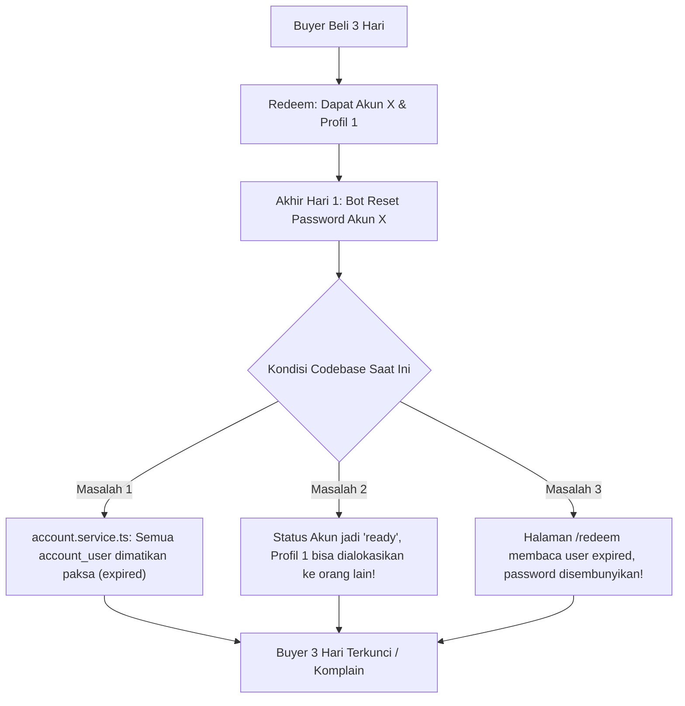
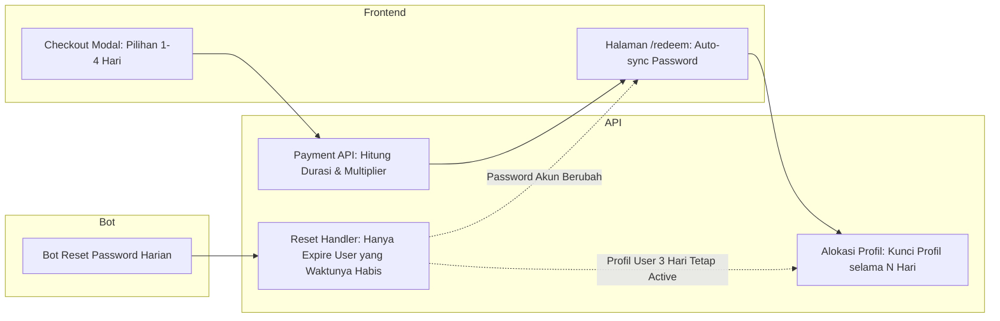

# Analisis & Rencana Implementasi: Fitur Multi-Hari (2–4 Hari) pada Varian Netflix Harian

Dokumen ini menganalisis ide bisnis dan rancangan teknis untuk memungkinkan pelanggan membeli varian **Netflix Harian** sekaligus untuk **2, 3, hingga 4 hari** dalam satu kali checkout (CO), tanpa harus membuat varian baru yang berisiko membuat stok akun menganggur (*idle stock*).

---

## 1. Analisis & Validasi Ide Bisnis

### Permasalahan Saat Ini
1. **Friction Pelanggan Tinggi**: Pembeli yang ingin sewa Netflix 3 hari harus melakukan checkout 3 kali terpisah (3x bayar QRIS, 3x simpan link voucher).
2. **Dilema Varian Baru (3 Hari)**: Jika dibuat varian tersendiri (misal: "Netflix 3 Hari"), sistem harus mengalokasikan akun/profil khusus untuk 3 hari. Mengingat volume pembeli 3 hari jauh lebih sedikit dibanding pembeli 1 hari, akun-akun tersebut akan sering **menganggur (*idle*)**, menurunkan utilisasi inventaris (*inventory turnover*).

### Konsep Solusi Pelanggan
* Buyer memilih varian **Harian (1 Hari)**, tetapi di modal checkout tersedia opsi durasi: **1 Hari, 2 Hari, 3 Hari, atau 4 Hari** (dibatasi maks 4 hari karena di atas 4 hari lebih worth-it diarahkan ke varian 1 Minggu).
* Durasi masa aktif voucher dan akses user bertambah sesuai kelipatan hari yang dibeli.
* Akun tetap berjalan di pool **Harian** dan **di-reset password secara rutin/harian** oleh bot seperti biasa.
* Jika pelanggan ter-*logout* dari Netflix akibat reset harian, mereka cukup membuka kembali link voucher (`/redeem?code=...`) untuk menyalin password terbaru yang sudah disinkronisasi oleh bot.

### Kesimpulan Validasi
> [!NOTE]
> **Ide ini SANGAT BAGUS dan Efisien secara Bisnis!**
> Pendekatan ini memaksimalkan perputaran slot profil tanpa mengorbankan cashflow atau memecah pool akun. Namun, **secara teknis di codebase saat ini, tidak bisa hanya mengubah `voucher.expired_at` saja**. Ada mekanisme internal di API dan Bot reset yang harus disesuaikan agar alur ini berjalan mulus tanpa error.

---

## 2. Temuan Kritis di Codebase Saat Ini (Fact Check)

Berdasarkan pemeriksaan mendalam pada modul API (`apps/api`), Bot (`apps/bot2`), dan Landing Page (`apps/landingpage`), ditemukan beberapa kondisi yang **akan merusak sistem jika hanya masa aktif voucher yang ditambah**:



### 1. Masalah Utama: `account_user` Dimatikan Paksa saat Reset Akun
Di file `apps/api/src/modules/account/account.service.ts` (baris 740–748):
```typescript
if (updateAccountDto.status === 'ready') {
  await this.postgresProvider.rawQuery(
    'UPDATE account_user SET status = \'expired\', expired_at = :now WHERE account_id = :accountId AND status = \'active\'',
    { replacements: { accountId, now: new Date() }, transaction, type: QueryTypes.UPDATE }
  );
}
```
* **Dampak**: Begitu bot selesai mereset password di akhir hari ke-1 dan mengembalikan status akun menjadi `ready`, **semua user di akun tersebut langsung di-set `expired`**, termasuk user yang baru jalan 1 dari 3 hari.
* Akibatnya, saat user membuka `/redeem`, sistem memeriksa `isExpired = user.expired_at < NOW()`, lalu menyembunyikan password dan menampilkan label *"Masa Langganan Habis"*.

### 2. Masalah Profil Slot Collision (Tabrakan User di Profil yang Sama)
* Di `public.service.ts`, penentuan slot kosong dihitung dari:
  ```typescript
  const activeUsers = await this.accountUserRepository.count({
    where: { account_profile_id: profile.id, status: 'active' }
  });
  if (activeUsers < profile.max_user) { /* Slot tersedia */ }
  ```
* Jika user 3 hari dimatikan statusnya menjadi `expired` di hari ke-1, maka di hari ke-2 profil tersebut dianggap kosong (`activeUsers = 0`).
* Pembeli baru varian 1 hari bisa saja masuk ke profil yang sama. Keduanya akan berebut profil dan melebihi batasan layar (*screen limit* Netflix).

### 3. Masalah Penjadwalan Reset Bot (`batch_end_date`)
Di `apps/api/src/modules/account-user/account-user.service.ts`:
```sql
WITH max_expiry AS (
  SELECT MAX(au.expired_at) as max_expired_at
  FROM account_user au
  JOIN account_profile ap ON ap.id = au.account_profile_id
  WHERE ap.account_id = :accountId AND au.status = 'active'
)
UPDATE account a
SET batch_end_date = (SELECT max_expired_at FROM max_expiry)
WHERE a.id = :accountId;
```
* Jika ada 1 user yang durasinya 3 hari di Akun X, maka `batch_end_date` akun tersebut akan diset ke **3 hari ke depan**.
* Ini menyebabkan bot **TIDAK AKAN mereset akun di hari ke-1 dan ke-2**. Akibatnya, user-user lain di profil 2, 3, 4 yang belinya cuma 1 hari akan mendapatkan **akses gratis hingga hari ke-3**.

---

## 3. Desain Solusi & Rencana Implementasi

Agar ide brilian Anda dapat berjalan 100% aman dan andal, berikut arsitektur perubahannya:



---

### Detail Komponen Perubahan

### A. Frontend: Landing Page (`apps/landingpage`)

1. **Checkout Modal (`apps/landingpage/src/components/checkout-modal.tsx`)**:
   * Khusus varian dengan kata kunci *"Harian"* atau `duration <= 24 jam`, tampilkan selector durasi hari:
     * Opsi tombol: `[ 1 Hari ]` `[ 2 Hari ]` `[ 3 Hari ]` `[ 4 Hari ]`.
   * **Kalkulasi Harga Otomatis**:
     $$\text{Total Bayar} = \text{Harga Varian} \times \text{Pilihan Hari}$$
     *(Bisa juga ditambahkan diskon bundle kecil jika ingin menarik, misal 3 hari dapat potongan 5%, tapi harga flat x multiplier sudah sangat oke).*
   * **Banner Edukasi Transparan**:
     > *"Paket Harian Multi-Hari (2–4 Hari): Password akun di-refresh otomatis setiap 24 jam untuk keamanan sharing. Jika ter-logout di Netflix, Anda cukup buka kembali halaman voucher Anda untuk mengambil password baru."*
   * Kirim payload `duration_multiplier` ke API saat membuat pembayaran.

2. **Halaman Redeem (`apps/landingpage/src/app/redeem/page.tsx`)**:
   * Tampilkan label status masa aktif yang jelas: *"Aktif hingga: [Tanggal & Jam]"* (misal 3 hari dari sekarang).
   * Beri tombol *"Refresh Password / Cek Password Terbaru"* agar pembeli dengan mudah memeriksa jika sewaktu-waktu ter-logout.
   * Sertakan notifikasi ramah: *"Password baru saja diperbarui oleh sistem pada jam [X]. Silakan gunakan password terbaru ini untuk login kembali."*

---

### B. Backend: Transaksi & Voucher (`apps/api`)

1. **DTO Pembayaran (`CreatePaymentDto`)**:
   * Tambahkan properti opsional `duration_multiplier?: number` (default `1`, validasi `1 <= duration_multiplier <= 4`).

2. **Pembuatan Transaksi & Voucher (`public.service.ts` -> `createPayment`)**:
   * `total_price = variant.price * multiplier`.
   * Simpan metadata multiplier atau hitung expired voucher awal:
     `voucherExpiry = new Date(Date.now() + (variant.voucher_expiry_hours || 24) * multiplier * 3600 * 1000)`.
   * Catat durasi efektif pada `TransactionItem` / `Voucher`.

3. **Proses Redeem Voucher (`public.service.ts` -> `redeemVoucher`)**:
   * Hitung masa aktif user berdasarkan multiplier:
     $$\text{expiredAt} = \text{Date.now}() + (\text{variant.duration} \times \text{multiplier})$$
   * Buat `AccountUser` dengan `expired_at = expiredAt`.
   * Update `voucher` dengan `expired_at = expiredAt`.

---

### C. Backend: Penyesuaian Reset Bot & Manajemen User Akun (KUNCI UTAMA)

Agar akun tetap bisa di-reset harian bagi user lain tanpa memutus user 3 hari:

1. **Ubah Logika Reset User di `account.service.ts` (`updateAccount`)**:
   * Jangan matikan semua user saat status akun di-set `ready`!
   * Ubah query agar **hanya mematikan user yang masa aktifnya memang sudah habis**:
     ```sql
     -- SEBELUMNYA (MEMATIKAN SEMUA USER):
     UPDATE account_user SET status = 'expired', expired_at = :now 
     WHERE account_id = :accountId AND status = 'active';

     -- PERBAIKAN (HANYA MEMATIKAN USER YANG SUDAH HABIS MASANYA):
     UPDATE account_user SET status = 'expired' 
     WHERE account_id = :accountId 
       AND status = 'active' 
       AND expired_at <= :now;
     ```
   * **Hasilnya**: User 3 hari yang `expired_at`-nya masih di hari esok/lusa **tetap berstatus `active`** di profil tersebut.

2. **Penentuan Status Akun Pasca-Reset**:
   * Jika di akun tersebut masih ada profil yang aktif (milik user 3 hari):
     * Akun tetap bisa diberi status `ready` agar profil-profil lainnya (profil 2, 3, dst) yang kosong bisa diisi oleh pembeli harian baru!
     * Di `redeemVoucher`, profil milik user 3 hari akan otomatis dilewati karena `activeUsers >= profile.max_user`. Profil yang kosonglah yang akan diberikan ke pembeli baru.

3. **Penjadwalan Reset Berikutnya (`batch_end_date`)**:
   * Alih-alih menggunakan `MAX(au.expired_at)`, untuk akun varian harian gunakan **jadwal reset berikutnya berdasarkan user yang paling cepat habis** atau interval 24 jam dari reset terakhir:
     ```sql
     WITH next_expiry AS (
       SELECT MIN(au.expired_at) as next_expired_at
       FROM account_user au
       JOIN account_profile ap ON ap.id = au.account_profile_id
       WHERE ap.account_id = :accountId AND au.status = 'active'
     )
     UPDATE account a
     SET batch_end_date = (SELECT next_expired_at FROM next_expiry)
     WHERE a.id = :accountId;
     ```
   * Dengan begitu, setiap kali ada user 1 hari yang habis, bot akan terpicu untuk reset password. User 1 hari yang habis tidak bisa login lagi, user 3 hari tinggal salin password baru dari voucher!

---

## 4. Perbandingan Opsi Alternatif

| Kriteria | Opsi 1: Multi-Hari Voucher Dinamis (Ide Anda + Penyesuaian API) | Opsi 2: Beli 1 Kali Dapat N Kode Voucher Harian Terpisah | Opsi 3: Buat Varian Khusus "3 Hari" |
| :--- | :--- | :--- | :--- |
| **Pengalaman Pembeli (UX)** | ⭐⭐⭐⭐⭐ **Sangat Simpel**: 1 Link voucher untuk seluruh hari, profil tidak berganti-ganti. | ⭐⭐⭐ **Sedikit Repot**: Pembeli dapat 3 voucher, tiap hari harus redeem kode baru dan dapat profil berbeda. | ⭐⭐⭐⭐ **Standar**: 1 Voucher, tidak perlu relogin harian. |
| **Efisiensi Akun / Stok** | ⭐⭐⭐⭐⭐ **Maksimal**: Berbagi akun dengan varian 1 hari, nol akun nganggur. | ⭐⭐⭐⭐⭐ **Maksimal**: Masuk antrean stok harian biasa. | ⭐⭐ **Buruk**: Akun sering menganggur jika permintaan 3 hari sepi. |
| **Kompleksitas Codebase** | ⭐⭐⭐ **Menengah**: Perlu penyesuaian query reset di API & multiplier di frontend. | ⭐⭐ **Rendah**: Cukup loop create voucher saat checkout berhasil. | ⭐ **Sangat Rendah**: Cuma tambah varian di database. |
| **Risiko Screen Limit** | Rendah (karena profil terkunci untuk user tersebut selama N hari). | Rendah. | Rendah. |

---

## 5. Rekomendasi & Langkah Selanjutnya

Ide Anda adalah **pilihan paling ideal dan tepat sasaran** untuk bisnis toko Netflix digital saat ini:
1. **Tidak membuang modal** untuk stok akun varian sepi.
2. **Meningkatkan omzet (AOV - Average Order Value)** karena pelanggan yang mau 2–4 hari tidak ragu untuk langsung checkout banyak hari.
3. Yang dibutuhkan hanyalah **mengamankan logika reset backend** agar user multi-hari tidak terputus di tengah jalan saat reset harian berjalan.

### Rencana Pengerjaan (Ketika Anda Siap Mulai Coding):
1. **Fase 1 (Backend API Database & Schema)**:
   * Menambahkan field `duration_multiplier` pada DTO payment dan logic pembuatan voucher.
   * Memperbaiki query expire user di `account.service.ts` agar hanya menonaktifkan user yang `expired_at <= NOW()`.
   * Menyesuaikan perhitungan `batch_end_date` akun agar reset harian tetap jalan tepat waktu.
2. **Fase 2 (Frontend Landingpage)**:
   * Menambahkan tombol pemilihan durasi (1, 2, 3, 4 Hari) pada modal checkout varian harian.
   * Menambahkan copywriting info auto-reset harian pada modal checkout dan halaman `/redeem`.
   * Memastikan halaman `/redeem` menampilkan info akun selama `user.expired_at` masih berlaku.
3. **Fase 3 (Testing & Simulasi)**:
   * Test skenario beli 2 hari -> lakukan simulasi reset password -> cek apakah voucher di `/redeem` menampilkan password baru dan profil tetap aman.

